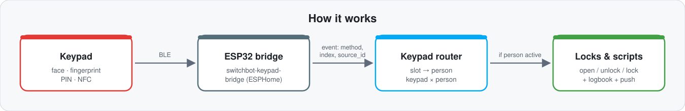
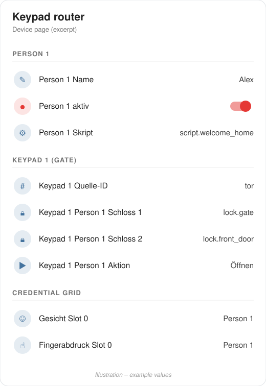

# SwitchBot Vision Keypad Ultra Customizer

[English](README.md) · **Deutsch**

[](https://hacs.xyz)


Eine kleine Home-Assistant-Integration zwischen einer Keypad-Bridge (z. B. [switchbot-keypad-bridge](https://github.com/pierluigizagaria/switchbot-keypad-bridge)) und deinen Schlössern/Skripten. Sie beantwortet eine Frage sauber: **Wer hat das Keypad benutzt – und was soll deshalb passieren?**

Trotz des Namens ist sie nicht SwitchBot-spezifisch – jede Integration, die beim Entriegeln ein Event mit `method` und Credential-`index` feuert, funktioniert.

## So funktioniert's



## Warum

Bridges wie switchbot-keypad-bridge feuern pro Entriegelung ein Event mit `method` (`pin` / `nfc` / `fingerprint` / `face`) und einem Credential-`index`. Dieser Index gilt **pro Methode** – Gesichts-Slot `0` und Fingerabdruck-Slot `0` sind zwei verschiedene Credentials, die zufällig dieselbe Nummer haben. Das direkt per Helfer-Liste auf „wer hat aufgeschlossen“ abzubilden, wird schnell unübersichtlich.

Diese Integration löst das mit ein paar kleinen, festen Tabellen – alle live auf der Geräteseite, nichts versteckt in einem Einstellungsdialog:

- **6 Personen.** Jeweils mit Name, optionalem Skript und einem Ein/Aus-Schalter fürs Dashboard. Die Personen gelten für alle Keypads – dieselbe Personentabelle und dasselbe Zugriffsprotokoll, egal welches Keypad jemanden erkannt hat.
- **Bis zu 2 Keypads.** Jedes mit einer **Quelle-ID**, die zum Feld `source_id` im Event der Bridge passen muss – so lassen sich zwei Keypads mit demselben Event-Typ unterscheiden. Für jedes Paar Keypad × Person bis zu 3 Zielschlösser und eine Aktion (Öffnen / Entriegeln / Verriegeln) für alle. Was das Credential einer Person auslöst, hängt also davon ab, *welches Keypad* sie erkannt hat (z. B. öffnet das Tor-Keypad Tor + Haustür zusammen, das Haustür-Keypad nur die Haustür).
- **Ein Credential-Raster.** Für jedes Paar (Methode, Slot) – 4 Methoden × 6 Slots – wählt ein Dropdown, zu welcher der 6 Personen es gehört. Ebenfalls für alle Keypads gemeinsam: Wer auf einem zweiten Keypad im selben Slot angelernt wird, braucht hier keine weitere Einstellung.

Bei jedem Entriegeln-/Verriegeln-/Klingel-Event ermittelt die Integration die Person, schreibt den Zugriff ins Logbuch, sendet eine Push-Meldung (falls eingerichtet) und führt – wenn der Schalter der Person an ist – die Schlossaktion aus, die *für diese Person an genau diesem Keypad* eingestellt ist, plus das optionale Skript der Person. Protokolliert wird immer, unabhängig vom Schalter: Wer jemanden abschaltet (die Putzhilfe zwischen den Terminen, ein Kind mit Gartentor-Verbot), verliert also keine Zugriffshistorie. Ein Event, dessen `source_id` zu keinem Keypad passt, wird trotzdem protokolliert und gemeldet – nur ohne Schlossaktion.

**Bewusst nicht dynamisch.** Sechs Personen, zwei Keypads, vier Methoden, sechs Slots, je drei Schlösser – fest. Kein „weitere Person/weiteres Keypad hinzufügen“-Dialog, der gepflegt werden muss. Wer mehr braucht, erhöht die Konstanten in `const.py`; es skaliert genauso.

**Namen sind statisch** („Person 1 Name“, „Keypad 1 Person 1 Schloss 1“ …) statt dem aktuellen Namen der Person zu folgen – sonst wäre ausgerechnet das Feld, in dem man den Namen *setzt*, das einzige, dessen Beschriftung sich nie anpasst, und damit schwer zu finden. Der eingegebene Name erscheint als *Wert* dieser Entität, nicht in der Beschriftung aller anderen.

## Installation

### HACS (benutzerdefiniertes Repository)

1. HACS → Integrationen → ⋮ → Benutzerdefinierte Repositories.
2. `https://github.com/dr-apple/ha-switchbot-vision-keypad-ultra-customizer` hinzufügen, Kategorie „Integration“.
3. „SwitchBot Vision Keypad Ultra Customizer“ installieren, Home Assistant neu starten.

### Manuell

Den Ordner `custom_components/keypad_router` nach `config/custom_components/` kopieren und Home Assistant neu starten.

## Einrichtung

1. **Einstellungen → Geräte & Dienste → Integration hinzufügen → „SwitchBot Vision Keypad Ultra Customizer“**.
2. Die drei Event-Typen der Bridge eintragen (Standardwerte passen zu switchbot-keypad-bridge: `esphome.switchbot_keypad_unlock`, `esphome.switchbot_keypad_lock`, `esphome.switchbot_keypad_doorbell`) und optional ein Notify-Ziel für Push-Meldungen.
3. Die Geräteseite öffnen. Alles Weitere wird dort als normale Entitäten eingestellt:
   - **Person N Name** (Text) – wer das ist. Für alle Keypads.
   - **Person N Skript** (Auswahl) – optionales zusätzliches Skript. Für alle Keypads.
   - **Person N aktiv** (Schalter) – Aktionen dieser Person überall aussetzen, ohne ihre Einstellungen anzufassen; protokolliert wird trotzdem. Für alle Keypads.
   - **\<Methode> Slot \<N>** (Auswahl, ein Satz fürs ganze Gerät) – zu welcher Person ein Credential aus Methode + Slot gehört. Für alle Keypads.
   - **Keypad N Quelle-ID** (Text) – eine kurze ID (z. B. `tor`, `haustuer`). Denselben Text in der YAML dieser Bridge als `source_id` in den Events `on_unlock`/`on_lock`/`on_doorbell` eintragen (siehe Beispiel unten). So unterscheidet der Router zwei Keypads, die denselben Event-Typ feuern.
   - **Keypad N Person M Schloss 1/2/3** (Auswahl) – bis zu drei Schlösser, die *dieses Keypad* auslöst, wenn es Person M erkennt.
   - **Keypad N Person M Aktion** (Auswahl) – Öffnen / Entriegeln / Verriegeln, gilt für alle oben gewählten Schlösser dieses Paars.



*Illustration – Ausschnitt der Geräteseite mit Beispielwerten.*

Keine YAML-Konfiguration, kein Optionsdialog – einfach die Entitäten ausfüllen. Die einzige YAML ist die ESPHome-Konfiguration der Bridge selbst; sie braucht eine `source_id` in den Event-Daten, um Keypads zu unterscheiden:

```yaml
switchbot_keypad_bridge:
  on_unlock:
    - homeassistant.event:
        event: esphome.switchbot_keypad_unlock  # same event name on every bridge
        data:
          method: !lambda 'return method;'
          index: !lambda 'return to_string(index);'
          source_id: "haustuer"  # matches this bridge's "Keypad N Quelle-ID"
  on_lock:
    - homeassistant.event:
        event: esphome.switchbot_keypad_lock
        data:
          source_id: "haustuer"
  on_doorbell:
    - homeassistant.event:
        event: esphome.switchbot_keypad_doorbell
        data:
          source_id: "haustuer"
```

Alle Bridges verwenden **dieselben** Event-Namen (also eine gemeinsame Personentabelle und ein gemeinsames Zugriffsprotokoll), aber jede ihre eigene feste `source_id`.

## Beispiel-Dashboard

Die Geräteseite zeigt schon alles, aber eine eigene Dashboard-Ansicht gruppiert es für den Alltag besser – ein Block pro Person und das Credential-Raster aufgeteilt in einen Block pro Methode (wie die Slots am Keypad organisiert sind):

```yaml
type: sections
title: Schließsystem
path: schliesssystem
icon: mdi:door-closed-lock
max_columns: 3
sections:
  - type: grid
    cards:
      - type: heading
        heading: Person 1
        icon: mdi:account-key
      - type: entities
        title: Person 1
        show_header_toggle: false
        entities:
          - entity: switch.keypad_person_router_person_1_aktiv
            name: Aktiv
          - entity: select.switchbot_vision_keypad_ultra_customizer_person_1_skript
            name: Skript
          - entity: text.switchbot_vision_keypad_ultra_customizer_keypad_1_quelle_id
            name: "Keypad 1 (Quelle-ID)"
          - entity: select.switchbot_vision_keypad_ultra_customizer_keypad_1_person_1_schloss_1
            name: "Keypad 1 → Schloss 1"
          - entity: select.switchbot_vision_keypad_ultra_customizer_keypad_1_person_1_schloss_2
            name: "Keypad 1 → Schloss 2"
          - entity: select.switchbot_vision_keypad_ultra_customizer_keypad_1_person_1_aktion
            name: "Keypad 1 → Aktion"
          - entity: text.switchbot_vision_keypad_ultra_customizer_keypad_2_quelle_id
            name: "Keypad 2 (Quelle-ID)"
          - entity: select.switchbot_vision_keypad_ultra_customizer_keypad_2_person_1_schloss_1
            name: "Keypad 2 → Schloss 1"
          - entity: select.switchbot_vision_keypad_ultra_customizer_keypad_2_person_1_aktion
            name: "Keypad 2 → Aktion"
  - type: grid
    cards:
      - type: heading
        heading: Gesicht
        icon: mdi:face-recognition
      - type: entities
        title: Gesicht
        show_header_toggle: false
        entities:
          - entity: select.switchbot_vision_keypad_ultra_customizer_gesicht_slot_0
            name: Slot 0
          - entity: select.switchbot_vision_keypad_ultra_customizer_gesicht_slot_1
            name: Slot 1
  - type: grid
    cards:
      - type: heading
        heading: Fingerabdruck
        icon: mdi:fingerprint
      - type: entities
        title: Fingerabdruck
        show_header_toggle: false
        entities:
          - entity: select.switchbot_vision_keypad_ultra_customizer_fingerabdruck_slot_0
            name: Slot 0
  - type: grid
    column_span: 3
    cards:
      - type: heading
        heading: Zugriffsprotokoll
        icon: mdi:history
      - type: logbook
        title: Wer hat es benutzt
        entities:
          - lock.tor_tor_lock_ultra
        hours_to_show: 168
        grid_options:
          columns: full
          rows: 6
```

Die Blöcke „Gesicht“/„Fingerabdruck“ für PIN und NFC und den Block „Person 1“ pro Person duplizieren – so viele, wie du tatsächlich eingerichtet hast.

## Beispiel-Automation

Jeder erkannte Zugriff steht bereits im Logbuch. Wer zusätzlich eigene Reaktionen will – z. B. nachts beim Aufschließen das Flurlicht einschalten –, triggert direkt auf das Bridge-Event:

```yaml
triggers:
  - trigger: event
    event_type: esphome.switchbot_keypad_unlock
    event_data:
      source_id: haustuer
conditions:
  - condition: sun
    after: sunset
actions:
  - action: light.turn_on
    target:
      entity_id: light.flur
```

## Fehlersuche

| Problem | Lösung |
|---|---|
| Zugriff protokolliert, aber keine Schlossaktion | Ist der Schalter *Person N aktiv* an? Passt die `source_id` im Event exakt zur *Keypad N Quelle-ID*? |
| Als unbekannte Person protokolliert | Methode + Slot im Credential-Raster (*<Methode> Slot <N>*) der Person zuordnen. |
| Gar keine Events | Unter *Entwicklerwerkzeuge → Ereignisse* auf `esphome.switchbot_keypad_unlock` lauschen und das Keypad benutzen. |
| Keine Push-Meldung | Bei der Einrichtung ein Notify-Ziel eintragen (z. B. `notify.mobile_app_mein_handy`). |

## Hinweise

- Alle Entitäten bleiben über Neustarts erhalten (`RestoreEntity`); ein nie angefasster Personen-Schalter ist standardmäßig an.
- Die Schloss- und Skript-Auswahlen listen live alle `lock.*`- bzw. `script.*`-Entitäten – neue erscheinen ohne Neuladen.
- Jede Änderung (Name, Schloss, Aktion, Skript, Credential-Slot) aktualisiert die Optionen des Eintrags und lädt ihn neu, damit andere Anzeigenamen sofort stimmen.
- Entity-IDs entstehen einmalig aus dem (oft leeren) Anfangsnamen und benennen sich später nicht um – nur Anzeigename/Wert ändern sich. Das ist normales Home-Assistant-Verhalten, kein Fehler.
- Das Logbuch wird per `logbook.log` an der ersten eingestellten Schloss-Entität geschrieben, damit Einträge bei einem echten Gerät erscheinen statt unter der Integration.

## Lizenz

MIT – siehe [LICENSE](LICENSE).
